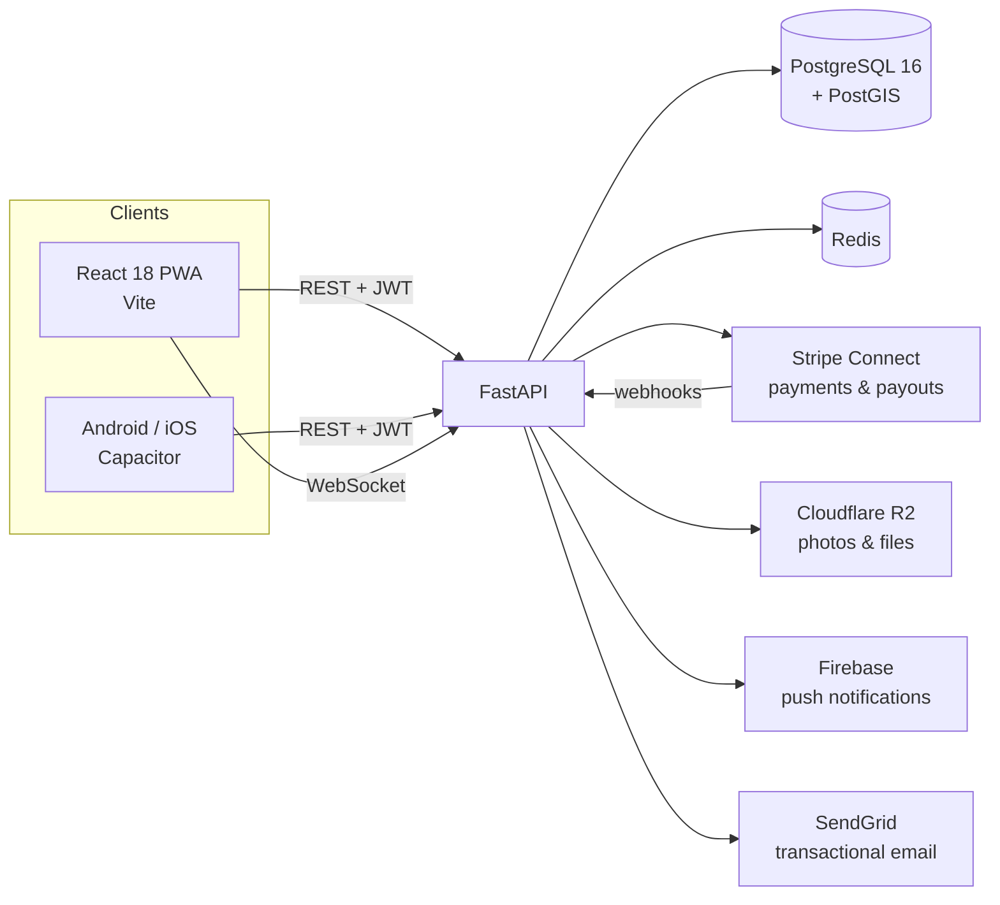

# RaceTrack

**A full-stack platform for organising and running popular road races in Spain**: from registration and payments to bib numbers, live timing and results, plus the community and sponsorship layer around each event.

> 🔒 The source code is private because this is a product in active development. This repository documents what it does and how it is built. Happy to walk through the code in an interview.

---

## At a glance

| | |
|---|---|
| Lines of code | ~66,000 (31k Python · 35k JavaScript) |
| Automated tests | **2,165** (1,066 backend with pytest · 1,099 frontend with Vitest) |
| Database migrations | 57 (Alembic) |
| API modules | 32 REST routers + WebSocket channels |
| Commit history | 760+ commits, feature branches merged through pull requests |
| Built | May 2026 – present, solo |

## What it does

**Runners** discover races on a map, register with custom forms and price tiers (with a waitlist when a race sells out), pay online, download a PDF bib with a QR code, and get their results and achievements after the race.

**Organisers** create and publish events with routes and elevation profiles, manage volunteers, checklists and incidents on race day, check runners in by QR code, import timing results, and receive payouts through Stripe Connect.

**Sponsors** browse sponsorship opportunities, negotiate packages with terms, sign agreements (generated as PDF contracts) and receive reports.

**Communities** let running clubs organise meetups and challenges, and post announcements.

## Architecture

## Engineering decisions worth discussing

- **Geospatial data in the database.** Start points and routes are stored as PostGIS geometries, so map search and distance queries run in SQL instead of in application code.
- **Idempotent payment webhooks.** Every processed Stripe event is recorded, so a retried webhook can't register or refund a runner twice.
- **Marketplace payments.** Stripe Connect splits each registration between the platform and the organiser, with payouts to connected accounts and refunds when an event is cancelled.
- **Session revocation.** A per-user token version invalidates every issued JWT at once, for example after a password reset.
- **Schema evolution.** 57 reviewed migrations; one-off data migrations are kept as explicit scripts, separate from schema changes.
- **Test-first workflow.** Behaviour changes ship with tests on both layers (pytest and Vitest).
- **Accessibility.** Modal focus trapping and focus restoration, keyboard navigation and semantic markup.

## Tech stack

| Layer | Technology |
|---|---|
| Backend | Python 3.12, FastAPI, SQLAlchemy 2.0, Pydantic v2, Alembic |
| Database | PostgreSQL 16, PostGIS 3.4, GeoAlchemy2, Redis |
| Frontend | React 18, Vite 5, PWA, Vitest + Testing Library |
| Mobile | Capacitor (Android and iOS) |
| Integrations | Stripe Connect, Google OAuth, Firebase Cloud Messaging, SendGrid, Cloudflare R2 |
| Documents | ReportLab (PDF bibs and contracts), QR codes |
| Infrastructure | Docker Compose, Railway |

---

**Lorena Marcos** · Applied Data Science, Universidad Complutense de Madrid · [LinkedIn](https://www.linkedin.com/in/lorena-marcos-6516272b5/) · [GitHub](https://github.com/Lorenadata)
